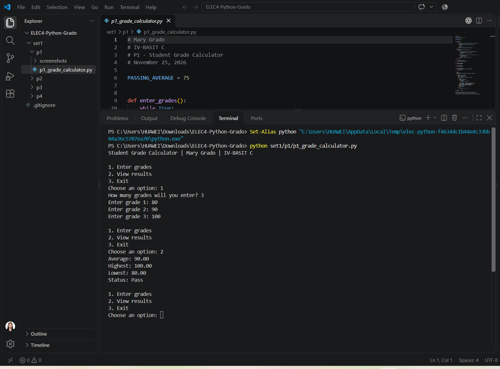
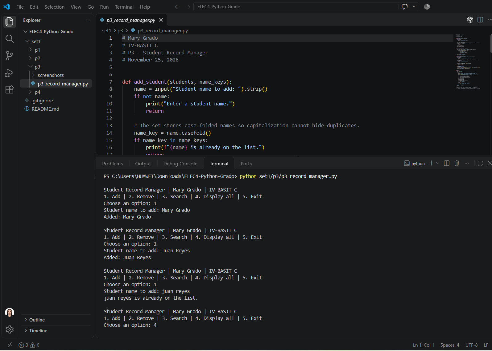
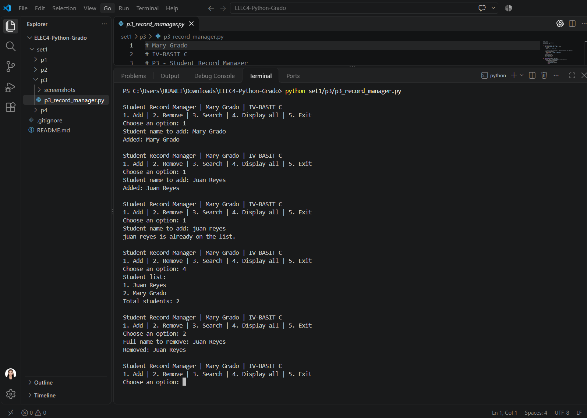
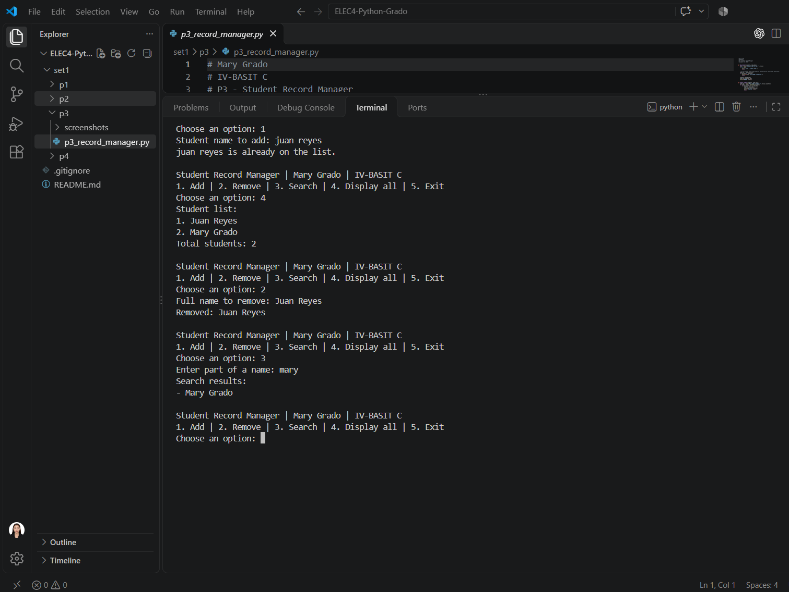
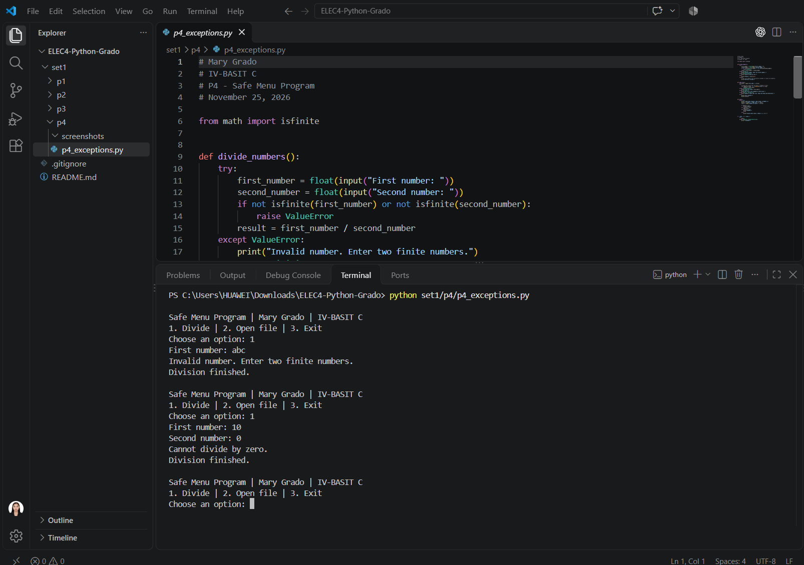
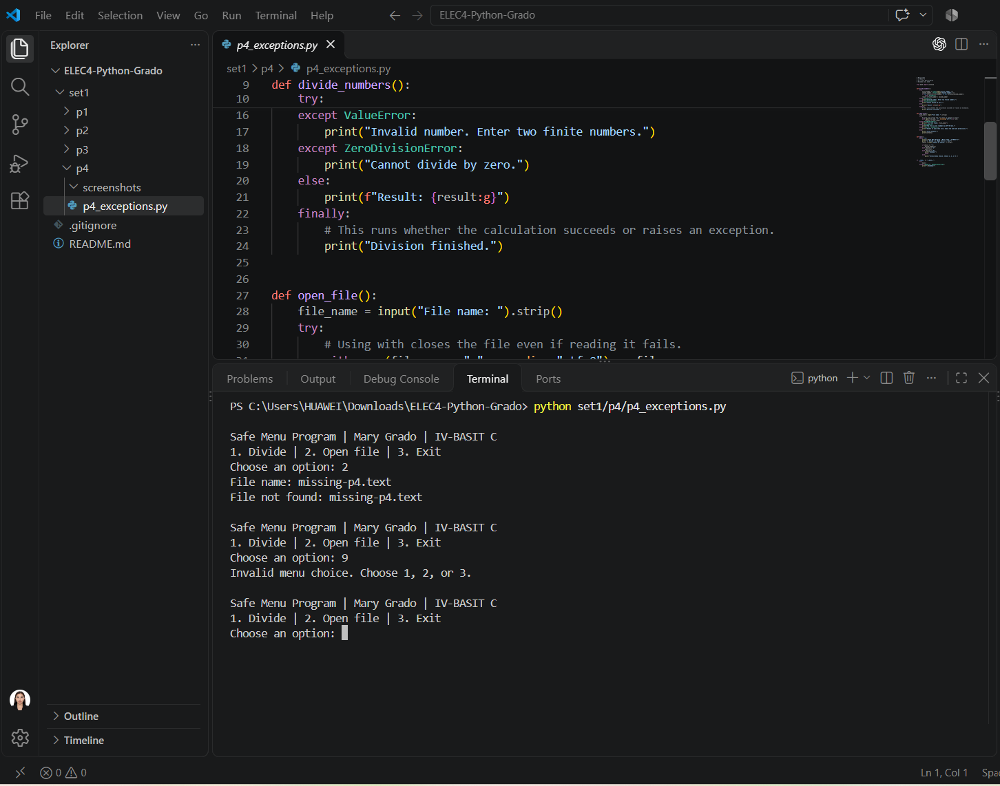

# ELEC 4 - Python Programming

**Name** Mary Grado  
**Section** IV-BASIT C

## Set 1

| Activity | Description |
| --- | --- |
| [P1 - Student Grade Calculator](set1/p1/) | Validates grades and reports the average, highest and lowest scores, and pass/fail status. |
| [P2 - Custom Module: student_utils](set1/p2/) | Imports reusable grade functions and adds the report date and time. |
| [P3 - Student Record Manager](set1/p3/) | Adds, removes, searches, and displays student names with case-insensitive duplicate checks. |
| [P4 - Safe Menu Program](set1/p4/) | Handles invalid numbers, division by zero, missing files, and invalid menu choices. |

### P1 - Student Grade Calculator

From the repository root, run:

```powershell
python set1/p1/p1_grade_calculator.py
```



### P2 - Custom Module: student_utils

From the repository root, run:

```powershell
python set1/p2/p2_main.py
```

Enter comma-separated grades such as `80, 90, 100`.


### P3 - Student Record Manager

From the repository root, run:

```powershell
python set1/p3/p3_record_manager.py
```







### P4 - Safe Menu Program

From the repository root, run:

```powershell
python set1/p4/p4_exceptions.py
```




